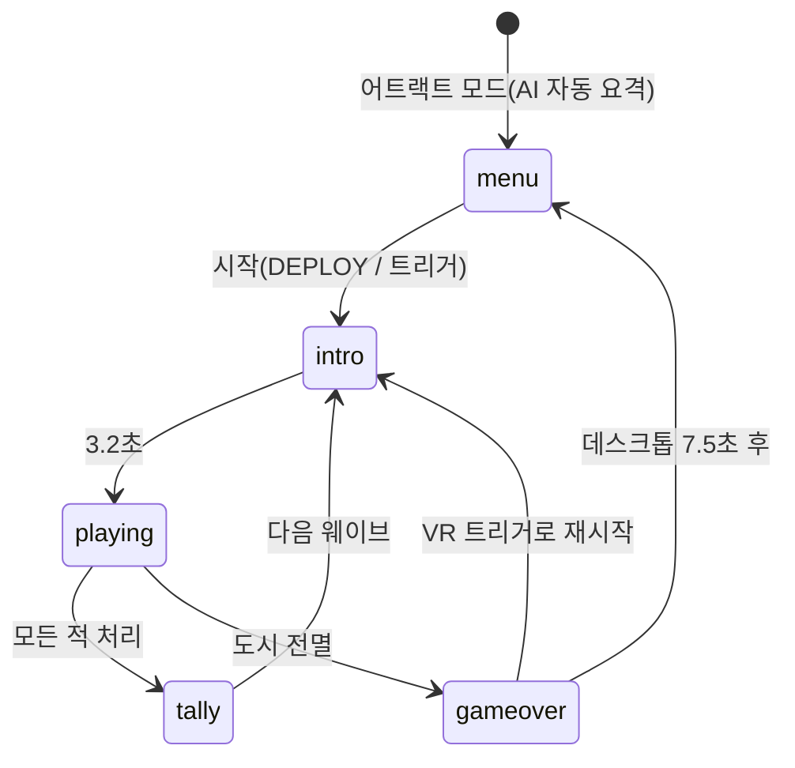

# MISSILE COMMAND XR — 구현 계획

WebXR(VR) + 데스크톱/모바일에서 동작하는 3D 미사일 커맨드 게임. 외부 에셋 없이 모든 그래픽·사운드를 절차적으로 생성한다.

## 1. 기술 스택

| 항목 | 선택 | 이유 |
|---|---|---|
| 렌더러 | Three.js r187 `WebGLRenderer` | WebXR 지원이 가장 안정적 |
| 번들러 | Vite | 빠른 개발 서버, `--host`로 헤드셋 접속 |
| 후처리 | `UnrealBloomPass` (데스크톱 전용) | XR에서는 EffectComposer 미지원 → 직접 렌더 |
| 오디오 | WebAudio + `THREE.AudioListener` | 절차적 버퍼 합성, HRTF 공간 음향 |
| 에셋 | 없음 (Canvas/GLSL로 생성) | 로딩 0, 배포 간단 |

## 2. 월드 레이아웃 (단위: m)

- 플레이어: 원점의 지휘 타워 데크(높이 16m) 위. -Z 방향을 바라봄.
- 9개 슬롯을 전방 100° 호(반경 ~58m)에 배치: `포대 · 도시×3 · 포대 · 도시×3 · 포대`
- 적 출현: 고도 125~160m, 반경 120~190m, 전방 150° 호.
- 지형: simplex fBm 계곡 + 능선 노이즈 산맥, 슬롯 주변 평탄화, 호수(수면 평면).


## 3. 모듈 구조

| 파일 | 역할 |
|---|---|
| `src/main.js` | 렌더러/카메라/리그, VR 진입, 블룸, 리사이즈, 메인 루프 |
| `src/config.js` | 레이아웃·웨이브 난이도·점수 상수 |
| `src/World.js` | 하늘 셰이더(별·달·구름·은하수), 지형, 조명, 타워, 가로등 |
| `src/Game.js` | 상태 머신, 웨이브 스폰, 충돌, 점수, 보너스 정산, 어트랙트 모드 |
| `src/entities/City.js` | 인스턴스드 빌딩 + 절차적 창문 셰이더, 서치라이트, 파괴/잔해/화재 |
| `src/entities/Battery.js` | 포대 모델, 포탑 조준/반동, 탄약 랙(10발) |
| `src/entities/Missiles.js` | 적 미사일, MIRV, 스마트 폭탄(회피), 폭격기/위성, 요격 미사일 |
| `src/fx/Particles.js` | GPU 빌보드 인스턴스 파티클 (시스템당 드로우콜 1개) |
| `src/fx/Trails.js` | 카메라 정렬 리본 트레일 (인스턴스 세그먼트) |
| `src/fx/FX.js` | 화구/충격파 셰이더, 고정 크기 조명 풀, 지면 충돌 연출 |
| `src/Audio.js` | 폭발·발사·사이렌 합성, 생성형 앰비언트 + 긴장도 비트 |
| `src/ui/Input.js` | 마우스/터치/키보드 + XR 컨트롤러, 자동 거리 측정 레티클, 햅틱 |
| `src/ui/Hud.js` | DOM HUD, VR 콘솔/메시지 패널, 월드 공간 점수 팝업 |

## 4. 핵심 설계 결정

1. **조준 = 방향은 플레이어, 깊이는 자동.** 3D/VR에서는 깊이 지각이 약하므로 레티클이 조준선 7° 이내의 위협(비행 시간만큼 선행 예측)의 거리로 스냅한다. 위협이 없으면 지형 교차점 또는 85m.
2. **고전 규칙 유지:** 폭발 연쇄 반응, 포대당 10발, 웨이브 종료 시 잔탄×5·생존 도시×100 (배율 적용), 10,000점마다 보너스 도시.
3. **XR 성능:** 블룸·그림자 비활성화, 포인트 라이트 6개 고정 풀(셰이더 재컴파일 방지), 파티클/트레일은 단일 드로우콜, 고정 포비에이션.
4. **XR에서 카메라 흔들림 금지**(멀미 방지) — 대신 햅틱과 하늘 섬광으로 피드백.

## 5. 게임 흐름



## 6. 웨이브 난이도 (`waveConfig`)

| 요소 | 등장 | 증가 |
|---|---|---|
| 미사일 수 | 1웨이브 | 10 + 3n (최대 48) |
| 속도 | 1웨이브 | 7 + 1.15n m/s (최대 26) |
| MIRV 분열 | 2웨이브 | 확률 최대 42% |
| 폭격기/위성 | 3웨이브 | 최대 5기, 비행 중 탄두 투하 |
| 스마트 폭탄 | 5웨이브 | 폭발을 회피 기동 |
| 점수 배율 | — | 2웨이브마다 +1 (최대 ×6) |

## 7. 조작

- **데스크톱:** 마우스 조준(시점이 커서를 살짝 따라감), 클릭/Space = 가장 가까운 포대에서 발사, `1/2/3` 또는 `A/S/D` = 특정 포대, `Esc`/`P` = 일시정지.
- **VR:** 컨트롤러 레이저 조준, 트리거 = 발사, 그립 = 일시정지. 양손 사용 가능.
- **모바일:** 탭 = 해당 지점으로 발사.

## 8. 작업 체크리스트

- [x] 프로젝트 스캐폴딩 (Vite, three)
- [x] 유틸리티(노이즈, 절차적 텍스처)
- [x] 파티클 / 트레일 / 폭발 FX
- [x] 월드(하늘, 지형, 타워, 조명)
- [x] 도시 / 포대 / 미사일 엔티티
- [x] 오디오 엔진
- [x] HUD / 입력
- [x] 게임 로직
- [x] `main.js` 부트스트랩 + VR 버튼 + 블룸
- [x] Vite 설정 (HTTPS 옵션 — 헤드셋은 보안 컨텍스트 필요)
- [x] 빌드 검증 + 헤드리스 Chrome 스크린샷으로 렌더 확인 (`scripts/smoke.mjs`, `scripts/flow.mjs`)
- [x] README
- [ ] 실제 헤드셋(Quest) 실기 테스트 — 프레임레이트·조준감 튜닝

## 9. 실행

```bash
npm install
npm run dev            # http://localhost:5173
npm run dev:https      # 헤드셋에서 LAN 접속 시 (자체 서명 인증서)
npm run build
```

## 10. 범위 밖 (향후)

AR 테이블탑 모드, 핸드 트래킹 핀치 발사, 온라인 리더보드, 그래픽 품질 옵션 메뉴.
